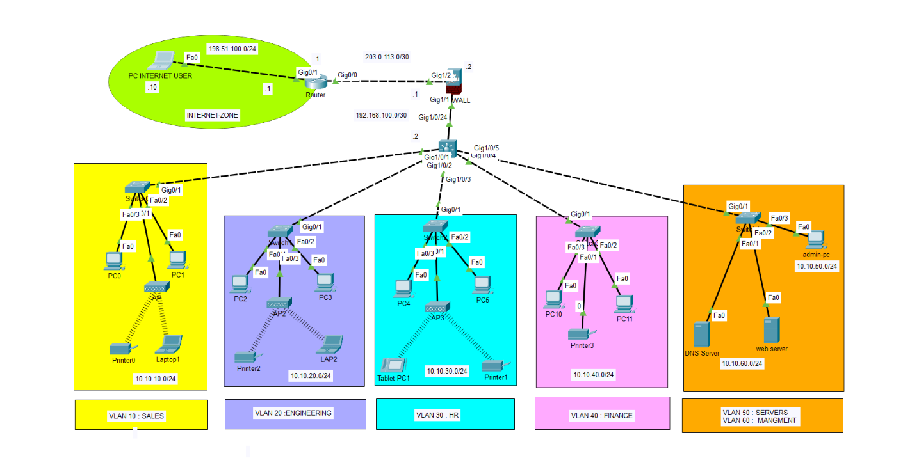
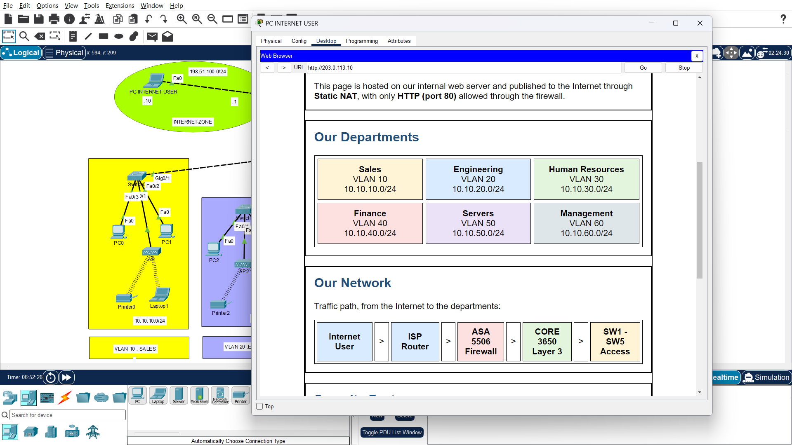
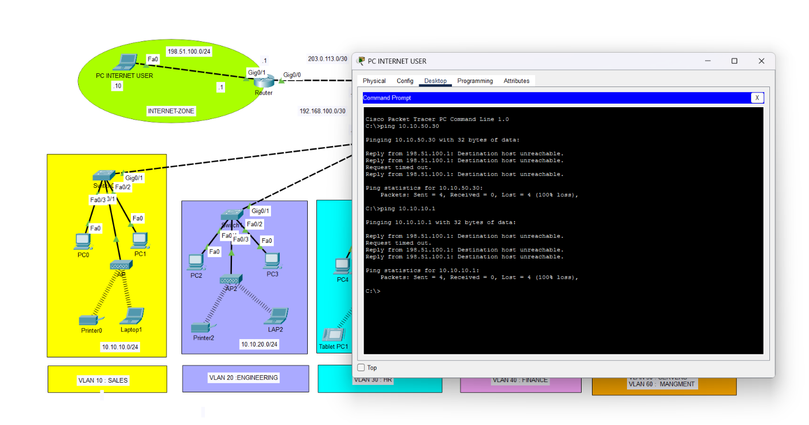

# Secure Hierarchical Network (Cisco Packet Tracer)

A medium-sized enterprise network designed around **security first**: VLAN segmentation, a Layer 3 core, an ASA perimeter firewall, and restricted management access. Built and tested in Cisco Packet Tracer.



## Architecture

```
Internet User  ~ ISP Router (2911)  ~  ASA  5506  ~ CORE 3650 (L3)  ~  SW1..SW5 (2960)
```

- **Single core, hierarchical design**, kept intentionally simple and easy to extend.
- **Inside** = security level 100, **Outside** = security level 0.

## Addressing

| VLAN | Department  | Network        | Gateway     |
|------|-------------|----------------|-------------|
| 10   | Sales       | 10.10.10.0/24  | 10.10.10.1  |
| 20   | Engineering | 10.10.20.0/24  | 10.10.20.1  |
| 30   | HR          | 10.10.30.0/24  | 10.10.30.1  |
| 40   | Finance     | 10.10.40.0/24  | 10.10.40.1  |
| 50   | Servers     | 10.10.50.0/24  | 10.10.50.1  |
| 60   | Management  | 10.10.60.0/24  | 10.10.60.1  |

| Link          | Network            |
|---------------|--------------------|
| CORE - ASA    | 192.168.100.0/30   |
| ASA - ISP     | 203.0.113.0/30     |
| Internet User | 198.51.100.0/24    |

Servers: DNS `10.10.50.20`, Web `10.10.50.30` (published as `203.0.113.10`). Admin PC: `10.10.60.10`.
Public ranges used are documentation-only (TEST-NET), suitable for a lab.

## Security Features

- **Segmentation:** 6 VLANs, inter-VLAN routing with SVIs on the CORE.
- **Layer 2:** Port Security (sticky MAC, max 1, violation shutdown), PortFast, BPDU Guard on access ports.
- **Internal policies (ACLs on the CORE):**
  - Finance cannot reach Sales.
  - Sales can reach the servers on DNS and HTTP only.
- **Management:** SSH only, allowed only from the Admin PC (VLAN 60).
- **Perimeter (Cisco ASA):**
  - Dynamic PAT for internal networks going out.
  - Static NAT for the web server, with an ACL allowing **HTTP (TCP 80) only** from the Internet.
  - Everything else from the outside is denied.
- **Services:** DHCP on the CORE (VLANs 10-40), internal DNS (`www.company.local`), and an internal web server.

## Test Results

| Test                                    | Result  |
|-----------------------------------------|---------|
| Internet User -> Web Server (HTTP)      | Allowed |
| Internet User -> Internal PCs (ping)    | Denied  |
| Internet User -> Web Server (ping)      | Denied  |
| Finance -> Sales                        | Denied  |
| Sales -> Servers (DNS, HTTP)            | Allowed |
| Sales -> Servers (ping)                 | Denied  |
| SSH from Admin PC                       | Allowed |
| SSH from any other PC                   | Refused |

The web server is reachable from the Internet over HTTP only:



Internal hosts stay unreachable from the Internet:



## Design Decisions and Limitations

- **No redundancy** (single core, no HSRP or EtherChannel): intentional, to keep the project focused on security and easy to explain. Listed as future work.
- **Static addressing for servers and admin**, DHCP for user VLANs.
- **ICMP workaround on the ASA:** with the outside interface at security level 0, return ICMP replies were not passing in Packet Tracer, even with `inspect icmp` applied. Raising the outside level to 100 fixed it but would weaken the firewall, so I kept level 0 and added a narrow ACL permitting only `echo-reply` from the ISP (`203.0.113.1`). I suspect a Packet Tracer behavior, but I did not prove it. On a real ASA, stateful inspection should be enough.
- **ICMP from the Internet is denied on purpose**; only HTTP is exposed.
- **Unused access ports stay available** for future Access Points.
- **No external DNS:** from the Internet the site is opened by IP.

## Future Work

- Management ACL: only the Admin PC can reach VLAN 60.
- Native VLAN change on trunks.
- Redundancy (second core, HSRP, EtherChannel).
- Wireless access with a dedicated guest VLAN.
- Split DNS for external name resolution.

## Files

- `entreprise_projet1.pkt` : the Packet Tracer project (open with Packet Tracer 9.x).
- `Images/` : screenshots used in this README.
